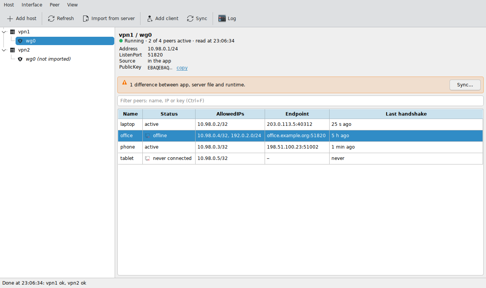
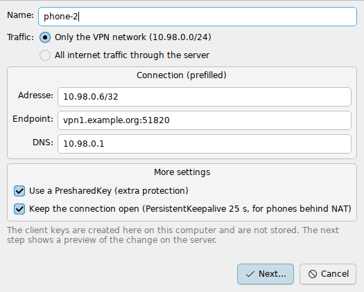
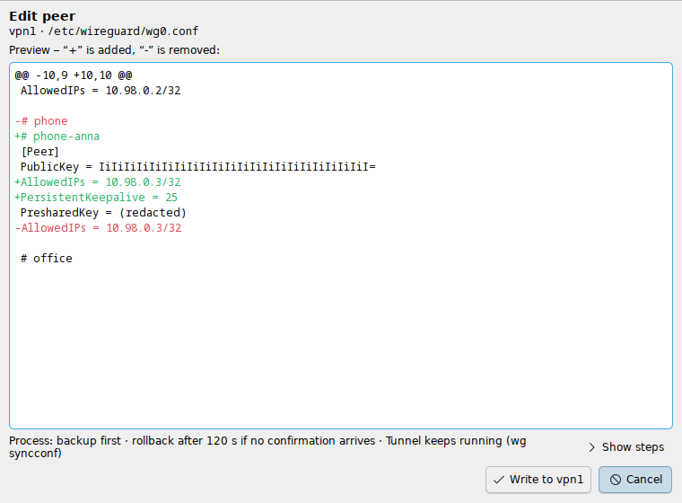
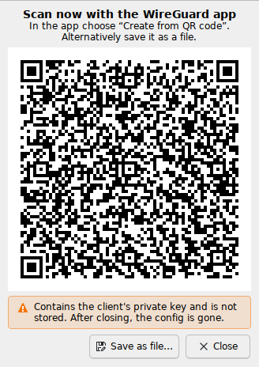
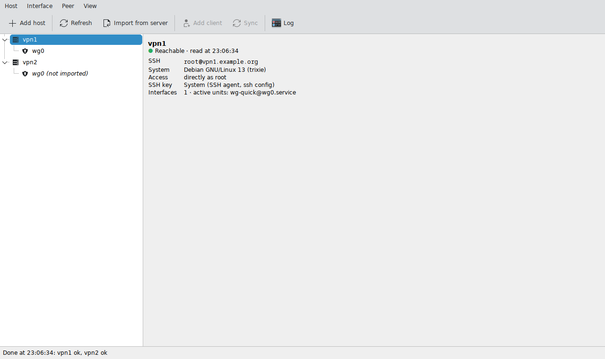
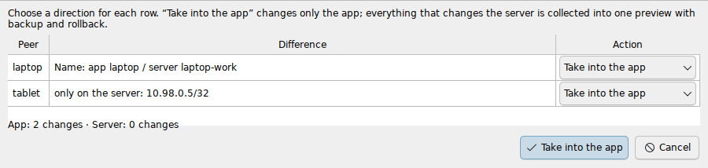
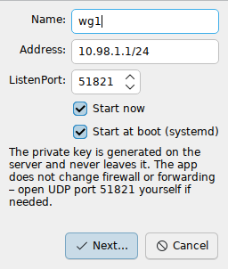
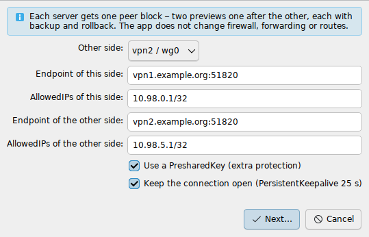

<p align="center"></p>

# WGGUI

**A Linux desktop app (Qt/KDE) to manage WireGuard® servers over SSH** – status, peers, new clients with QR code,
editing and syncing – with a diff preview, backup and automatic rollback for every change on a server.



## Features

- **Hosts over SSH** – uses your normal OpenSSH client and agent (or a per-host key), as `root` or via `sudo -n`.
- **Status at a glance** – interfaces, peers, last handshake, endpoint, traffic; filter and sort.
- **Add clients** – free address suggested, keys generated locally, QR code for the WireGuard mobile app or a
  `.conf` file. The client's private key is never stored.
- **Issue a new QR code** for an existing client (new keys, same name and address).
- **Edit, disable, remove peers** – disabling comments the block out and can be undone.
- **New servers and tunnels** – install `wireguard-tools`, create a new interface (the private key is generated on
  the server), and set up a server-to-server tunnel with both sides configured in one step.
- **Housekeeping** – clean up old backups (newest five are kept), optional automatic refresh every minute.
- **Sync** – shows differences between the app, the server file and the running interface; you choose the
  direction per peer.
- **Safe changes** – every write shows a diff first, checks the file is unchanged, makes a backup, starts a
  rollback timer on the server and only keeps the change after a second SSH call confirms it. Running tunnels are
  updated with `wg syncconf`, existing connections stay up.
- **Secrets stay on the server** – server private keys and preshared keys are redacted on the server before
  anything is transferred; edits run on the server (POSIX `sh`/`awk`).
- **Languages:** English, German, Spanish, Italian, Chinese, Japanese.

## Screenshots

| Add a client | Preview before writing | QR code |
|---|---|---|
|  |  |  |

| Host details | Sync app ↔ server | New interface | Server-to-server tunnel |
|---|---|---|---|
|  |  |  |  |

All screenshots use synthetic data (`example.org`, documentation IP ranges, test keys).

## Requirements

| Where | What |
|---|---|
| Desktop | Linux with Python ≥ 3.12 and the OpenSSH client – or the Flatpak (KDE runtime 6.11). Developed on KDE Plasma, works on other desktops. |
| Servers | Debian/Ubuntu, Fedora, RHEL 9/10 (and clones), Arch, Alpine or openSUSE with `sshd` and `wireguard-tools` (the app can install them); login as `root` or a user with passwordless `sudo`. |

Accept a new server's host key once in a terminal (`ssh <target>`); the app runs SSH in batch mode.

## Install

**From source** (uses [uv](https://docs.astral.sh/uv/); PySide6 from your distribution is preferred, otherwise
it is installed from PyPI):

```bash
git clone https://github.com/n8m4re/wggui.git && cd wggui
scripts/wggui.sh                 # creates .venv on first start
scripts/install-desktop.sh       # optional: menu entry with icon (--desktop: also a desktop launcher)
```

**Flatpak** (build locally):

```bash
flatpak install --user flathub org.flatpak.Builder org.kde.Sdk//6.11 org.kde.Platform//6.11 io.qt.PySide.BaseApp//6.11
scripts/flatpak-build.sh --bundle  # installs for your user and writes build-flatpak/wggui.flatpak
flatpak run io.github.n8m4re.WGGUI
```

The Flatpak may use the SSH agent and reads `~/.ssh` (read-only) for config, `known_hosts` and key files.

## What runs on a server

Only POSIX `sh`/`awk` scripts with fixed text; values are passed as arguments, secrets only via stdin.

| Action | Commands |
|---|---|
| Read | `cat /etc/os-release`, `id -u`, redacting `awk` on `/etc/wireguard/<if>.conf`, `wg show all dump`, `wg pubkey` (in a pipe), `systemctl list-units` |
| Install | package manager command for the distribution (shown before it runs) |
| New interface | `wg genkey` on the server, `<if>.conf` with mode 0600, rollback timer, `systemctl enable --now wg-quick@<if>` or `wg-quick up` |
| Write | `sha256sum` check → `cp -p` backup → `setsid` rollback timer → new file via `awk`/append → `mv` → `wg-quick strip` + `wg syncconf` → confirm |

Firewall rules and `sysctl` are never touched. Backups stay on the server as `/etc/wireguard/<if>.conf.wggui-<timestamp>`.

## Data on the desktop

| What | Where |
|---|---|
| Database (hosts, interfaces, peers, public keys – **no** private keys or PSKs) | `~/.local/share/wireguard-gui/wggui.db` |
| Log (keys masked) | `~/.local/state/wireguard-gui/wggui.log`, in the app with **Ctrl+L** |
| Generated SSH keys (optional) | `~/.local/share/wireguard-gui/ssh/` |

In the Flatpak these live under `~/.var/app/io.github.n8m4re.WGGUI/`.

## Development

```bash
uv run pytest                    # unit + GUI tests (offscreen)
uv run pytest -m integration     # real SSH against Debian, Ubuntu (sudo), Fedora, Alpine and AlmaLinux 9/10 (RHEL) containers (Docker)
uv run ruff check .
python3 scripts/i18n.py check    # translation catalogs complete
```

Documentation: [architecture](docs/architecture.md) · [supported distributions](docs/distros.md) ·
[troubleshooting](docs/troubleshooting.md) · [translations](docs/i18n.md) · [Flatpak](docs/flatpak.md).

## License

GPL-3.0-or-later – see [LICENSE](LICENSE). Dependencies and their licenses: [THIRD-PARTY-LICENSES.md](THIRD-PARTY-LICENSES.md).
Contributions: see [CONTRIBUTING.md](CONTRIBUTING.md).

WireGuard is a registered trademark of Jason A. Donenfeld. WGGUI is an independent project and is not affiliated
with or endorsed by the WireGuard project.
